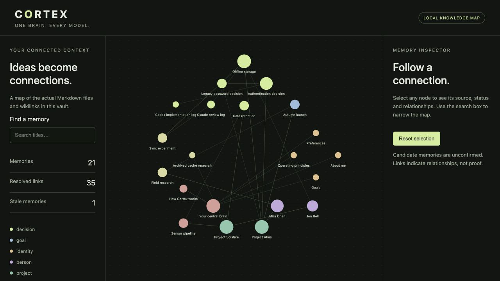
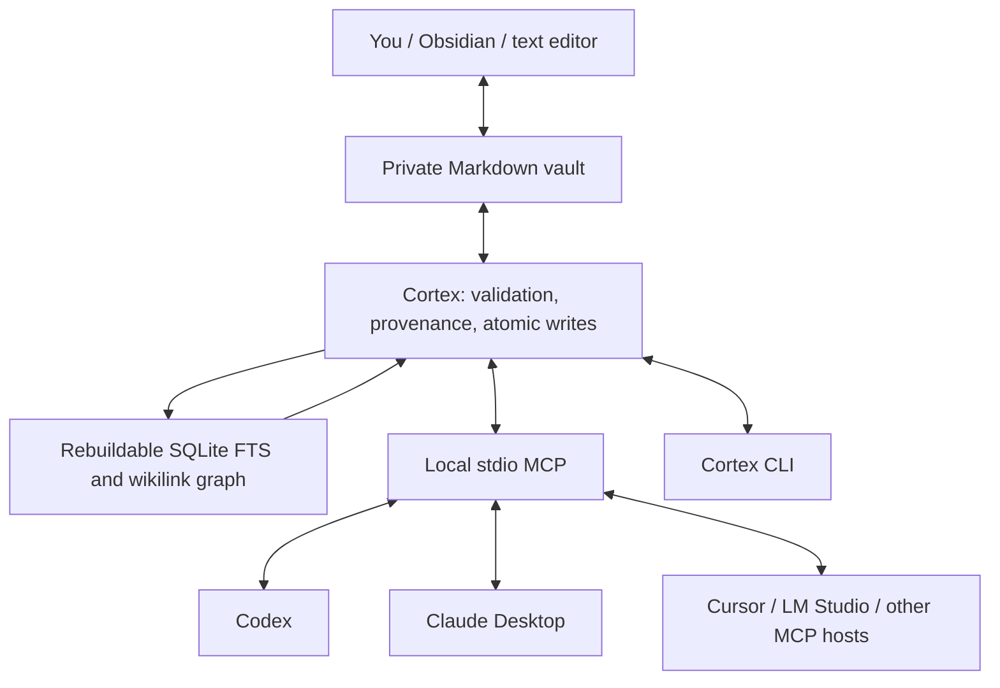

# Cortex

**One brain. Every model.**

Local-first memory and context for AI agents. Keep your knowledge in ordinary Markdown, edit it in Obsidian, and let Codex, Claude, Cursor or local models retrieve the same durable context through MCP.

**The model is not the memory.** Your files are the memory. The database can be rebuilt. Your model can be replaced.



## What works in 0.1

- Canonical Markdown with YAML provenance, confidence, status and timestamps.
- Exact title/path lookup, SQLite FTS5, metadata filters, recency ranking and wikilink traversal.
- Eleven MCP tools over local stdio using the official Python SDK.
- Candidate memories, explicit human confirmation, version-checked updates and reversible expiration.
- Provider-neutral activity summaries; a shared record of work actually performed.
- A CLI with real diagnostics, private Markdown backup and a network-free graph export.
- Codex and Claude Desktop registration helpers, plus Cursor and LM Studio configurations.
- Codex lifecycle context and instructions to save concise candidates before compaction/end. Hooks never capture transcripts and require normal user trust review.

## Five-minute local setup

Requires macOS or Linux, Python 3.11+, Git and [uv](https://docs.astral.sh/uv/getting-started/installation/). No cloud service, API key, Docker container, embedding model or paid subscription is required by Cortex.

```sh
git clone https://github.com/tejask-dev/cortex.git
cd cortex
uv tool install .
cortex init ~/Brain
cortex remember 'Use Markdown as the canonical format.' --title 'Storage decision'
cortex search 'Storage decision'
cortex doctor
```

If `cortex` is not on your PATH, follow `uv tool update-shell` or invoke `~/.local/bin/cortex`. `uv run cortex` works from the checkout during development.

Your private `~/Brain` **must remain outside this repository**. Initialization preserves existing files and provides a linked Home page and blank identity templates. Open the folder as a vault in [Obsidian](https://obsidian.md/download), or use any text editor.

```sh
cortex connect codex                 # preview
cortex connect codex --apply --write # merge registration, back up existing config
cortex hooks --install              # prepare hooks and append concise AGENTS guidance
# In a new Codex CLI session: /hooks → inspect and trust the Cortex definitions.
# Then use /mcp to inspect the server and ask Codex to call brain_status.
```

`--write` enables explicitly invoked candidate writes. Without it, mutating MCP tools refuse operations. Agents cannot promote a memory to confirmed through MCP. Client registration is separate from proving a live connection; restart the client and make a tool call. [Codex setup](docs/integrations/codex.md).

## Architecture



No hosted memory service. No runtime network calls or telemetry implemented by Cortex. **A connected cloud AI client can send retrieved content to its model provider.** Local storage does not make a cloud model private or offline. Vault files and backups are plaintext; Cortex is not an OS sandbox. See [security](docs/security.md).

## Daily use

```sh
cortex search 'authentication' --type decision --exclude-stale
cortex context 'Project Atlas' --depth 1
cortex recent
cortex activity
cortex log 'Implemented and checked the search index.' --agent codex --project cortex --task 'Search implementation'
cortex reindex
cortex backup
cortex open
```

Put global options first: `cortex --brain /path/to/vault --json search 'query'`. CLI and MCP call the same core.

`cortex read ID` returns the current `hash`. Updates require it:

```sh
cortex update ID --hash HASH --content 'Revised decision text'
cortex update ID --hash NEW_HASH --status confirmed --confirm # explicit human review
cortex forget ID --hash CURRENT_HASH                         # expires; does not erase
```

MCP tools: `brain_search`, `brain_read`, `brain_context`, `brain_remember`, `brain_update`, `brain_link`, `brain_forget`, `brain_recent`, `brain_activity`, `brain_reindex`, `brain_status`.

## See the connections

Obsidian Graph follows your actual wikilinks automatically. For the optional self-contained browser view:

```sh
cortex graph # exports ~/Brain/.cortex/graph.html; open this file locally
```

That export contains your private titles. Keep it private. For a shareable demonstration, create a **new, separate synthetic vault**:

```sh
cortex demo /tmp/cortex-demo
cortex --brain /tmp/cortex-demo graph --output /tmp/cortex-demo.html
```

The [demo HTML](examples/demo-graph.html), screenshot and benchmark in this repository contain only fictional data and starter templates. The graph is a static snapshot with search and node inspection, not a second storage system.

## Clients

| Client | Current support |
|---|---|
| [Codex](docs/integrations/codex.md) | Local stdio registration; lifecycle hooks require user trust |
| [Claude Desktop](docs/integrations/claude.md) | Local stdio configuration helper; restart required |
| [Cursor](docs/integrations/cursor.md) | Local stdio configuration helper |
| [LM Studio](docs/integrations/lm-studio.md) | Optional local-model MCP host; no model download required by Cortex |
| [Open WebUI](docs/integrations/open-webui.md) | Requires an additional HTTP/OpenAPI bridge; not direct stdio |
| [Obsidian](docs/integrations/obsidian.md) | Opens the same Markdown files; no community plugin required |

## Quality and limits

```sh
uv sync --locked
uv run pytest
uv run ruff check .
uv run ruff format --check .
uv run mypy
uv run cortex --json benchmark
```

Tests cover process concurrency, real stdio MCP calls, rebuilds, provenance, malformed files, path/symlink rejection, optimistic updates, configuration preservation and malicious-input regressions. GitHub CI runs on macOS and Linux with Python 3.11 and 3.13.

The [synthetic benchmark](examples/benchmark-results.json) measures exact/keyword retrieval, graph traversal, provenance, stale filtering, conflicting decisions and activity. It also includes a semantic paraphrase case that lexical search misses. This is a small smoke benchmark, not evidence of general recall quality. Embeddings are deliberately absent.

Current limits: every query scans Markdown for freshness, so large vaults need measurement; no file watcher or semantic search; no PDF/attachment ingestion; no background transcript summarization; no HTTP server for MCP; no irreversible delete tool. Custom YAML fields are retained across updates, with normalized formatting. The [memory model](docs/memory-model.md) specifies the schema. Uncooperative external editors can still race after the final hash check. Backups contain validated Markdown, not attachments or version history.

## Prior art and roadmap

Cortex does not claim to invent persistent agent memory. Basic Memory demonstrates Markdown plus MCP; Open Second Brain and obsidian-second-brain explore shared agent context; enquire-mcp emphasizes cited, freshness-aware retrieval. Cognee and Khoj address broader graph/product needs. Cortex's scope is an original small MIT implementation with files you own and an inspectable interface. [Research, licenses and maintenance evidence](docs/prior-art.md).

Next: incremental indexing, better duplicate/conflict diagnostics, measured semantic retrieval and a deliberate attachment pipeline. [Roadmap](docs/roadmap.md).

[Contributing](CONTRIBUTING.md) · [Security policy](SECURITY.md) · [MIT license](LICENSE)
