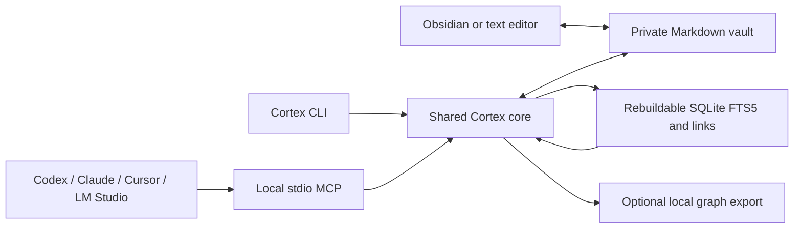

# Architecture

The model is not the memory. Cortex keeps durable knowledge in a private Markdown directory and gives local clients a shared retrieval interface. The source checkout and the private vault are separate directories.

## Storage

The default vault is `~/Brain`. Folders organize identity, projects, people, decisions, research, reference material and agent memory. Notes remain readable without Cortex or Obsidian. Attachments can live beside notes, but v0.1 indexes Markdown only.

`.cortex/brain.sqlite` contains parsed note records, an FTS5 index, link edges and indexing state. It is derived data. `.cortex/history/` preserves previous note versions when Cortex updates them; unlike the index, this history cannot be reconstructed from current Markdown. Keep history if rollback matters.

Initialization adds missing starter directories and candidate identity templates. It does not fill in personal facts. A valid existing note remains the user's property; initialization is not permission to replace it.

## Shared core

The CLI and MCP call the same `Brain` operations. Parsing validates frontmatter and supplies provenance. Filesystem access uses a vault boundary. Retrieval and mutation operate on those validated records, avoiding independent CLI and MCP interpretations of a note.

Cortex scans eligible files during operations so changes from an external editor become visible. A signature detects changed content and timestamps. When rebuilding, note records, full-text rows and link edges are replaced within one SQLite transaction. A vault-local advisory lock serializes participating Cortex processes. External editors do not take this lock; optimistic content hashes detect intervening edits, but Cortex cannot promise cross-application transactional editing.

## Retrieval

Search combines exact ID/path/title matches, SQLite full-text ranking and a recency contribution. Type, tag, status, date and stale filters constrain results. Tag filters require every requested tag. Candidate and confirmed notes are searchable by default; expired and superseded notes require an explicit status filter.

Wiki links resolve against note titles, path stems and vault-relative paths. A target that resolves to more than one note is left unresolved rather than guessed. Context expands incoming and outgoing resolved links with bounded depth, note count and serialized output size. It labels retrieved text as untrusted evidence and retains provenance. These labels guide clients; they do not enforce how a model will behave.

There is no embedding model, vector database, OCR pipeline or model provider call in the v0.1 runtime. Semantic paraphrases without lexical overlap are an expected weakness, recorded by the synthetic benchmark. A passing lexical test does not establish semantic retrieval quality.

## Client boundary

`cortex serve` speaks MCP over stdin/stdout. It opens no HTTP listener. `serve --write` opts that process into mutation tools; default client configurations omit it. Each client can start its own process against the same vault.

Configuration generators produce client entries with an absolute executable and explicit brain path. `connect` previews; `connect --apply` applies configuration. A saved entry does not prove the application loaded it. Test initialization, tool listing and a read/search in the actual client before reporting a connection.

Codex lifecycle integration supplies bounded context and reminders. Useful memories are explicitly distilled into candidate notes during work. Hooks do not scrape raw transcripts or invent summaries at session end. See [Codex integration](integrations/codex.md).

## Portability and limits

The implementation targets macOS and Linux with Python 3.11+, SQLite FTS5 and POSIX filesystem primitives. Windows is not a claimed v0.1 platform. The initial scan/rebuild design favors inspectability over very large vault performance. Network filesystems, cloud-sync races and concurrent arbitrary editors are not supported as a distributed database.

Obsidian is an optional UI over the same files, not a storage dependency. Open WebUI requires an additional transport bridge; a stdio entry alone cannot connect it. See [prior art](prior-art.md), [security](security.md) and the [roadmap](roadmap.md).
